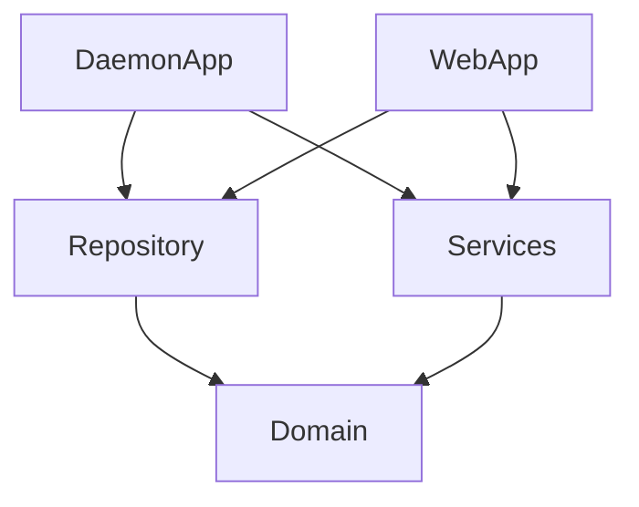

# Air Quality Alerts

The Air Protection Branch operates ambient air quality monitors throughout the state. These monitors send automated
notifications to a centralized APB mailbox when monitored values exceed certain thresholds. The APB has requested a new
application to take those notifications, translate them into understandable, actionable messages for the public, and
send them to various opt-in subscription lists.

This project is required by EPA as part of EPD's ozone attainment maintenance plan for Atlanta. We are implementing it
statewide to provide a better understanding of real-time air quality.

## Solution organization

The solution contains the following projects along with their corresponding unit test projects.

* **Domain** — A class library defining the data models and service interfaces
* **Services** — A class library implementing various services required by the apps
    * *MailRetrievalService* — A service to retrieve unprocessed emails from the mailbox
    * *ParserService* — A service to parse emails from the ambient monitors
    * *TemplatingService* — A service to generate messages for the public from the parsed emails
    * *DeliveryService* — A service to deliver the messages to the public
    * *NotificationService* — A service to notify administrators of failures or errors
* **Repository** — A class library implementing the repositories and data stores using Entity Framework
* **DaemonApp** — A Windows service accomplishing the main functionality
* **WebApp** — A web application for use by APB staff to monitor the status and past actions taken by the application

### Project dependency diagram

